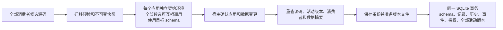

# 04 应用包、构建与生命周期

> 所属：[技术方案总览](README.md) ｜ 相关：[00 内核](00-kernel.md)、[03 运行时](03-app-runtime.md)、[05 协议](05-app-protocol.md)、[09 安全](09-security.md)、[10 工作间 VM](10-workbench-vm.md)
>
> 依据：[system-architecture.md](../research/system-architecture.md) 第 3 节、[tech-assessment.md](../research/tech-assessment.md) 第 3.12 节

## 1. 职责

定义应用的结构和统一的包格式，并管理应用从诞生到卸载的全过程：创建、构建、校验、安装、升级、回滚、卸载、导出。三类产物共用同一套结构和安装流程。

## 2. 应用的结构

每个应用的源码树（Builder 的工作目录，一个 git 仓库）：

```
apps/<id>/src/
├── manifest.json            # 清单（第 3 节）
├── interface/
│   ├── interface.json       # 接口定义，接口的真相源（05）
│   └── schemas/             # 应用私有的类型（可选）
├── core.js                  # 无界面核心：工具、订阅、数据逻辑（03 第 4 节）；大了可以拆成 core/ 下的模块
├── ui/
│   └── index.html           # 界面；大了再拆成 ES 模块
├── tests/
│   ├── contract.json        # 契约测试（05 第 13 节）
│   └── smoke.json           # 冒烟测试的输入步骤和检查项
├── SKILL.md                 # 给 Agent 看的使用说明：什么时候用这个应用、常见用法
└── SPEC.md                  # 应用规格说明：用途、关键设计决定、已知问题；Builder 每次修改后更新
```

B 类原生应用把 `core.js` 和 `ui/` 换成 Swift 源码（`Sources/`），由宿主编译成 `.app`（第 5.2 节）。

## 3. 清单 `manifest.json`

```jsonc
{
  "schema": "agentos.app/1",
  "id": "3f2a9c4e-1b7d-4e8a-9c21-5d6f7a8b9c0d",   // 宿主分配的 UUID，稳定不变；原生应用的 bundle id 由它派生
  "version": "1.4.0+27",                           // 语义化版本 + 递增的构建号（第 7 节）
  "title": "待办", "icon": "✅",
  "runtime": { "kind": "web",                       // web | macos-native | wasm-component；OCI 通过 runtime.backend 声明
               "core": "core.js", "ui": "ui/index.html",
               "minHost": "26.0" },
  "interface": { "path": "interface/interface.json", "digest": "sha256:…" },
  "permissions": {                                  // 申请的能力，安装时转成能力授权（09 第 5 节）
    "network": [], "services": [], "files": [] },   // 数据集合、订阅、调用写在 interface.json 里
  "agent": { "sessionId": "…", "model": "claude-opus-5-5" },
  "update": { "previous": "1.3.2+26", "dataSchema": null },
  "source": { "recipe": "none" },                   // none | swiftc | swiftpm | cargo-component | containerfile
  // 以下字段在导出和 C 类构建时才有（P4）
  "artifacts": [], "provenance": null, "signature": null
}
```

- 清单和接口都由 Builder 编写，宿主在安装时校验；宿主不信任清单里的任何「授权」，只把它当申请。
- P1a 不做签名：签名者和校验者是同一台机器上的同一个宿主，意义不大。签名和构建证明只在导出、导入和 C 类构建时使用（第 8 节）。

## 4. 磁盘布局与迁移

```
~/Library/Application Support/AgentOS/
├── apps/<id>/
│   ├── src/                 # 源码工作区（git 仓库）；Builder 在这里改代码
│   ├── versions/<ver>/      # 已安装的各个版本，不可变
│   └── current -> versions/<ver>
└── system/                  # 宿主私有（00 第 9 节）：kernel.sqlite、meta/、agent/、logs/
```

- **scheme handler 只服务发起请求的那个应用的 `src/`（Builder 正在修改时）或 `current/`（其他时候）**，宿主数据永远不在这棵树里（[03](03-app-runtime.md) 第 5 节）。
- 应用私有数据：界面和核心的 `localStorage` 在 WebView 数据存储里；原生应用的数据在 `system/appdata/<id>/`，Seatbelt 规则只允许它读写这里。

**重建数据策略：** 默认目录为 `AgentOS-Rebuild/`，不自动移动旧 P0 数据。用户可显式导入新格式数据或签名包。旧应用如需迁移，需要重新生成核心、IDL 和契约测试后安装，不能把占位核心当作已通过验证的应用。

## 5. 产物类型与构建

| | A：JS 动态应用 | B：本地编译 | C：云端构建 | W：WASM 模块 | O：OCI 服务 |
|---|---|---|---|---|---|
| 阶段 | **P1a** | P4 | P4（按需） | P4 | P3 |
| 构建地点 | 不需要构建 | 用户的 Mac | 用户自己的 GitHub Actions | 本地或云端 | 本地（VM）或云端 |
| 构建耗时 | 0，重载约 5 ms | 热编译 0.4–0.7 s，首次 SwiftPM 构建约 30 s | 以分钟计 | 秒级 | 秒到分钟级 |
| 需要的工具链 | 无 | Command Line Tools（1.9 GB，已确认可以要求用户安装） | 无 | 内嵌 | 来宾内 umoci/runc |
| 运行时 | 界面 WebView + 核心宿主 | 原生进程 | 原生进程 | WASM | VM |
| 费用 | 只有模型调用费 | 免费 | 约 $0.062/分钟（`macos-26` runner），每次约 $0.06–0.5，费用归用户 | 免费 | 本地免费 |
| 适合场景 | 默认 | Metal、120 Hz、系统集成、导出成独立 `.app` | 依赖重、非 Mac 目标平台、可复现的分享构建 | 计算模块 | 后端和服务 |

### 5.1 A 类：不需要构建

Builder 在 `src/` 里修改，界面和核心直接从 `src/` 加载以便实时热更新。一轮修改结束、测试通过后，宿主把 `src/` 的提交导出成 `versions/<ver>/` 快照，`current` 指向它（第 6 节）。

### 5.2 B 类：本地编译（P4）

1. 检查工具链：`xcode-select -p`。如果没有，引导用户执行 `xcode-select --install`。Apple 的 SDK 按许可不能随 AgentOS 分发。
2. 编译：使用宿主固定的 `swiftc` 参数编译 `Sources/`；不执行 SwiftPM 插件或包内构建脚本。由宿主组装 `X.app/Contents/{MacOS, Info.plist, Resources}`，不需要 Xcode 工程。
3. 签名：链接器会自动做 ad-hoc 签名；宿主再根据能力授权生成 Seatbelt 规则，**包里自带的授权文件一律忽略**。
4. 编译错误作为工具结果返回给 Builder，进入修复闭环。
5. 也可以在 Workbench VM 里编译 Linux 目标（O 类后端、命令行工具）。

### 5.3 C 类：云端构建（用户自带 GitHub 账号，P4 按需）

```
Builder 打包源码和清单（以 sha256 标识）
 → 推送到用户自己的仓库（例如 <user>/agentos-builds），触发 workflow_dispatch
 → runner（macos-26 或 Linux）执行：构建 → ad-hoc 签名 → 跑测试 → 记录摘要 → 生成构建证明 → 上传产物
 → AgentOS 下载 → 校验摘要和构建证明 → 本地重新签名 → 按第 6 节安装
```

- 用户在设置里连接 GitHub（细粒度令牌，存在钥匙串里），AgentOS 帮用户创建构建仓库和工作流模板。
- 这个方案不碰 Apple 的签名和 Xcode 许可红线，费用和许可义务都归用户，和「自带 API Key」的思路一致。

## 6. 安装、升级、回滚、卸载

**安装和升级（所有类型通用，A 类在 P1a 实现）：**

1. **校验结构**：清单和 `interface.json` 符合 schema；接口 lint 通过（[05](05-app-protocol.md) 第 13 节）。
2. **计算副作用上限**：按申请的能力推导每个工具的上限（[05](05-app-protocol.md) 第 2.3 节）。
3. **接口兼容检查**（P1b）：和当前版本比较；破坏性变化列出受影响的依赖方，需要处理后才能继续（[05](05-app-protocol.md) 第 5 节）。
4. **权限对比**：新增或扩大的能力，按 [09](09-security.md) 第 5.2 节的规则授予（自动授予，或由外壳弹出授权框）。
5. **契约测试**：在临时的核心宿主和数据副本上运行，失败就终止。
6. **提交**：`src/` 做一次 git 提交，导出成 `versions/<ver>/`。
7. **切换**：原子切换 `current`；注册或更新接口；发出 `app.installed` 或 `app.updated` 事件。
8. **保留**：当前保留全部版本；自动压缩或清理需另行设计，不在升级时删除旧版本。
9. **数据迁移**：迁移预检必须在测试前完成，契约通过后先备份，schema/记录/激活版本同事务提交；任一步失败均不激活。

每个版本都记录测试结果。冒烟测试或契约测试没通过的版本仍然保留（用户可能想看），但在版本时间线里标红，不能成为 `current`。

**回滚：** 把 `current` 切回旧版本；`src/` 上追加一个「回到 x.y.z」的提交，这样 Builder 下次从回滚后的代码继续。**共享数据和 `localStorage` 都保留**；只有当这次升级做过用户 schema 迁移时，才询问是否连数据一起恢复。活动流里的「撤销这次修改」也走这条路（[00](00-kernel.md) 第 7 节）。

**卸载：** 注销接口、停投订阅并撤销能力授权；首版保留版本源码和私有数据以便恢复。**共享集合里的数据不删**：它属于用户，不属于应用；没有任何应用使用的用户集合，会在设置的「数据」页里列出，可以导出或删除（[08](08-data.md) 第 3 节）。

## 7. 版本与 git

- 每个应用的 `src/` 是一个 git 仓库。**Builder 每完成一轮修改（测试通过）提交一次**，而不是每写一个文件就提交；提交说明用这轮对话的请求摘要。
- 版本号采用 `主.次.修订+构建号`：Builder 加功能时提升次版本号，修 bug 时提升修订号，接口有破坏性变化时提升主版本号；构建号单调递增。
- Builder 一轮修改结束时调用 `app.commit` 触发第 6 节的安装流程。「回到昨天的版本」「对比两个版本」由 Agent 通过 `app.versions`、`app.diff`、`app.rollback` 完成。

## 8. 包格式 `.agentpkg`（导出、导入、C 类）

导出采用有界的 stored ZIP profile，不接受压缩和可执行元数据。源码和所需集合的 schema 始终附带；不附带用户记录、原作者授权或凭据。

```text
<id>-<version>.agentpkg
├── manifest.json          # agentos.archive/1：公钥与逐文件 SHA-256
├── signature.ed25519      # 对规范化描述符签名
└── payload/               # 激活版本的完整源码、IDL、契约和 data-schemas.json
```

- 最多 10000 个文件、200 MB 原始内容；拒绝路径穿越、符号链接、大小写别名、重叠条目及 CRC/摘要/签名不符。
- 私钥存在钥匙串。宿主展示签名者指纹供用户接受，签名不等于信任代码。
- 导入创建新 UUID 与命名空间，移除原作者会话/更新声明，保留包来源标签；重新申请授权，重新构建和运行契约。
- 原生导入重新编译源码，不直接运行包内 `.app`。独立 `.app`/单文件 HTML 分享属于后续按需出口。

## 9. 信任与 Apple 政策红线

- **AgentOS 是信任关口。** AgentOS 自己下载的文件不带隔离标记（没有设置 `LSFileQuarantineEnabled`），不会经过 Gatekeeper 检查，所以第 6 节和第 8 节的校验必须严格执行。用户从网页或邮件里下载的文件，则必须保留隔离标记。
- **不能用 AgentOS 的开发者证书给用户的应用签名。** 开发者计划许可协议 §5.1 禁止这样做，而且一旦证书被吊销，AgentOS 本体也无法运行。
- **不自建托管的 Xcode 构建服务。** Xcode 许可只允许内部使用，禁止通过网络供多台机器同时使用。
- **SwiftPM 依赖**要锁定版本，并使用白名单，防范供应链风险。

## 10. 里程碑

| 阶段 | 内容 |
|---|---|
| P0 ✅ | 简化的注册表（只有清单，没有版本） |
| P1a | 应用结构；目录迁移；git；A 类的安装、升级、回滚、卸载；版本时间线和测试结果；包管理工具（`app.create`、`app.commit`、`app.versions`、`app.diff`、`app.rollback`） |
| P1b | 接口兼容检查；能力授权框接入安装流程 |
| P3 | O 类服务（VM 内） |
| P4 | B 类本地编译和原生安装；`.agentpkg` 导出导入与签名；C 类云端构建（按需）；W 类 |

## 11. 待定问题

- 应用的命名空间和 UUID 之外，要不要给用户一个可读的「应用短名」用于 `aos` CLI 和 `@` 提及？建议直接复用命名空间。
- Builder 修改到一半（测试没过）时用户切走，`src/` 里的未提交修改怎么办？建议保留在工作区，下次打开时由 Builder 决定继续还是丢弃。

### 重建激活语义

当前激活版本以 kernel.sqlite 的 packages.version 为准。准备阶段生成不可变快照，契约测试在临时数据根运行，成功后登记版本和授权。已撤销授权不会因升级自动恢复。回滚保留数据；`update.dataSchema.plan` 指向 `agentos.migration/1` 声明，执行字段 rename/default/remove。其他应用仍依赖该集合时，必须通过 `apps.commitGroup` 一起提交候选版本。`current` 符号链接不作为权威状态。

迁移声明必须指定 collection/fromVersion/toVersion/definition/steps。`toVersion` 是当前版本加一；只支持用户集合，禁止包修改系统 schema。契约测试使用迁移后的 schema 和独立数据根。升级后的数据如需恢复，使用设置中的集合备份恢复；代码回滚不隐式恢复数据。`apps.diff` 对比已校验版本或工作区，返回文件摘要与有界文本差异。

OCI 后端使用 `runtime.backend={language:"oci",entry:"backend.oci.tar",files:["backend.oci.tar"]}`，并申请 `backend.call`。镜像要求与运行语义见 [VM 说明](../../vm/README.md)。其 UI/核心仍遵循同一协议，不直接运行在宿主进程中。


### 联合 schema 更新

`apps.commitGroup({apps:[id,…]})` 接受 1–20 个不同应用。宿主预检全部候选源码，收集 `update.dataSchema.plan`，要求每个受影响集合的所有已安装消费者都参加。一个集合只迁移一次；多个应用声明该集合时，版本、目标定义、步骤和预检结果必须一致。工具 IDL 如需改变 schema 引用或其他不兼容形状，必须联合纳入该应用的全部已安装调用方；预检和激活时均重新检查。单应用提交仍拒绝破坏性变更，宿主确认会明确列出接口变化，受影响固定自动化会按原规则暂停等待重新批准。



任一契约失败、确认被拒绝、预览过期或事务内错误都不激活任何候选。契约数据与活跃数据隔离；迁移预检逐条验证真实记录，契约使用自己的测试数据验证目标 schema。确认等待期间应用可继续运行，提交时要求参与核心空闲并阻止新调用；提交后旧核心和界面失效。数据库中的活动版本是唯一权威，失败时删除尚未登记的版本目录；源码 Git 提交只是修复历史。

设置 → 数据 → 联合更新可选择参与应用并执行同一路径。CLI 可以请求测试，但不能批准迁移；需要确认时返回 `needs_confirmation`。
