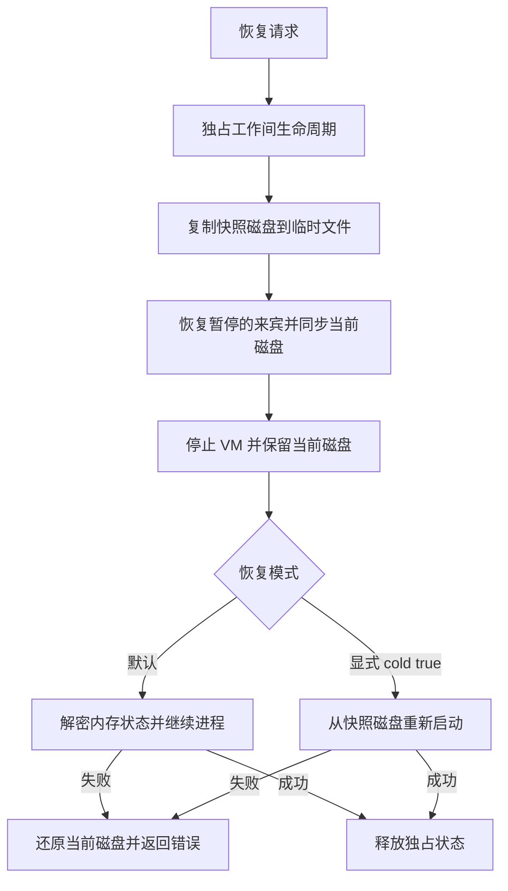

# 10 工作间虚拟机（Workbench VM）

> 所属：[技术方案总览](README.md) ｜ 相关：[02 Agent](02-agent.md)、[04 应用包](04-app-package.md)、[07 服务](07-system-services.md)、[09 安全](09-security.md)
>
> 依据：[system-architecture.md](../research/system-architecture.md) 第 2 节、[vm-experiments/](../research/vm-experiments/)、[tech-assessment.md](../research/tech-assessment.md) 第 3.9 节和第 6 节

## 1. 定位

**体验像 Parallels，实现像 WSL2。** 用户看到的是一个独立完整的 AgentOS 系统；系统内部有一台**用户看不见的 Linux 微虚拟机**，作为 Agent 的「工作间」，负责：

- **工具链**：apt、pip、npm、gcc、Rust、Go、ffmpeg、Python 等，Agent 拿到 root 权限，用户不用在 Mac 上安装任何东西。
- **应用后端和服务**：数据处理、爬虫、定时任务、数据库（O 类产物）。
- **不可信代码**：一次性脚本、网上下载的程序，放在临时微虚拟机里运行，用完即弃。
- **构建**：Linux 目标的编译；云端构建前的本地预检。
- **代码模式**：Agent 写一段脚本批量调用应用工具（[05](05-app-protocol.md) 第 9 节）。

**不把用户应用放进 VM**，原因有三：

1. Linux 来宾在 Apple 的虚拟化框架下没有 3D 加速。
2. 要让来宾应用逐个窗口地融入 Mac 桌面，等于自己再造一个 WSLg，工作量以月计；中文输入法、剪贴板这些也都要额外桥接。
3. 来宾占用的内存不会还给宿主。

所以应用界面一律在宿主上渲染。「体验像 Parallels」来自外壳（全屏桌面模式、独立的数据和回滚），不来自 VM。

**为什么放到 P3：** P2 的研究助手只需要搜索和网页正文提取，后者用隐藏的 WKWebView 就能完成（网页脚本本来就跑在 Apple 沙箱化的 WebContent 进程里，[07](07-system-services.md) 第 3.2 节）。VM 真正不可替代的是工具链、应用后端和不可信代码，它们从 P3 开始需要。

## 2. 实测数据（M5 Pro，48 GB，macOS 26.5）

| 项 | 结果 |
|---|---|
| 极简 Linux VM 启动（2 vCPU） | `start()` 72–87 ms；用户态就绪 230–300 ms |
| 空闲时占用宿主内存 | 配置 512 MB 时 115 MB；配置 4 GB 时 254 MB |
| 保存和恢复整机状态 | 512 MB：235 ms 和 172 ms；4 GB：675 ms 和 618 ms；状态文件 22–46 MB |
| 保存和恢复的兼容性 | 同时配置 virtio-gpu、virtiofs、NAT、vsock、Rosetta 共享时，仍能通过校验 |
| 内存归还 | **不归还**：Docker 的 VM 实际用了约 3.5 GB，宿主侧却被占住 24 GB |
| 容器启动参照 | `docker run --rm alpine true` 中位数 211 ms；`docker exec` 42 ms |

## 3. 实现

| 项 | 重建实施决定 |
|---|---|
| 技术栈 | 系统 Virtualization.framework，Apple Silicon / macOS 26；运行不依赖 Docker |
| 授权 | 宿主 virtualization entitlement；镜像内核与 rootfs 单独分发 |
| 实例 | 2 vCPU / 1 GiB；一台持久工作间，按需临时实例；每应用独立后端 VM，最多两个驻留后端 |
| 镜像 | arm64 kernel + ext4；独立可信 Ed25519 公钥验证清单，按声明字节数和 SHA-256 验证文件 |
| 控制通道 | 有界 JSON RPC 经 vsock；命令短期令牌绑定宿主运行，命令结束即失效 |
| 文件 | 不共享宿主目录。通过授权文件服务显式复制 ≤1 MB UTF-8；OCI 归档单独有界传输 |
| 网络 | 无网卡；`aos net.fetch` 显式请求宿主域名授权与出口策略，不实现透明 TCP/IP 网络栈 |
| 快照 | 保存磁盘与内存状态；本机解锁时完整恢复通过，锁屏时解密受限；冷恢复必须显式指定 |
| 更新 | 新基础镜像不可变存储，原子更新选择指针；已有磁盘保留，新实例使用新基础镜像 |
| 资源 | 命令 ≤120 秒、输出 ≤2 MB；后端单次 ≤20 秒、回复 ≤1 MB；闲置暂停，临时磁盘执行后清理 |

此前 Containerization、vminitd/gRPC、virtiofs 与用户态网络栈是候选方案。重建选择更小的强制边界：不给 VM 网卡、宿主挂载或私有凭据，联网和文件访问均为显式宿主操作。来宾包管理器不能直接联网；依赖需在构建镜像/OCI 时准备。

## 4. 对外接口（工具）

| 工具 | 说明 | 使用者 |
|---|---|---|
| `vm.exec({cmd, cwd?, env?, timeout?, ephemeral?})` | 执行命令，返回 stdout、stderr 和退出码；设置 `ephemeral` 时在临时微虚拟机里执行 | Agent、包管理 |
| `vm.fs.read` / `write` / `list` | 读写 VM 工作区里的文件 | Agent |
| `vm.service.start` / `stop` / `status` | 管理常驻服务（应用后端） | Agent、应用（通过 `call` 授权） |
| `vm.snapshot` / `restore` | 给工作间打快照、回滚 | Agent、恢复模式 |
| `vm.stats` | 内存、CPU、磁盘占用 | 外壳 |

- 应用后端使用 NDJSON 标准输入/输出协议，由 Web 核心声明的工具包装，按正常 IDL 参与调用和事件；不隐式注册一个免授权的 MCP Server。
- VM 里的命令行可以调用 `aos`，经 vsock 转发到宿主，主体是 `vm:<id>`，权限按发起它的运行计算（[00](00-kernel.md) 第 3.4 节）。
- `vm.exec` 的输出如果来自网络（例如下载的网页），宿主无法区分；所以执行过联网命令的 VM 会话，结果一律标为不可信。

## 5. 图形界面（补充方案）

- 默认没有图形界面。
- Agent 需要「看」Linux 图形应用时（computer use），用 Xvfb 加 noVNC 在一个 WebView 面板里显示，或者给它开一个整屏的 `VZVirtualMachineView` 窗口。
- 逐窗口融入 Mac 桌面的方案（类似 WSLg）暂不做。

## 6. macOS 来宾 VM（可选，P4）

- 唯一的用途是让 Agent **安全地操作真实的 Mac 应用**（computer use）。
- 限制：每台 Mac 最多同时运行 2 个；许可只允许开发、测试或个人非商业用途；App Store 登录不可用；每个来宾需要 4–8 GB 内存。启用前需要做许可评估。

## 7. 里程碑

| 阶段 | 内容 |
|---|---|
| P3 | 常驻 Workbench VM、镜像下载和更新、vsock 控制通道、用户态网络栈和出站白名单、virtiofs 授权目录、`vm.exec` 和 `vm.fs`、快照；临时微虚拟机；VM 服务作为应用后端接入总线；代码模式 |
| P4 | Xvfb 加 noVNC 图形面板；可选的 macOS 来宾 VM |

P3 之前先做 S7（[11](11-engineering.md) 第 8 节）：验证不配直通网卡时，VM 里的进程无法绕过白名单。

## 8. 风险

- Containerization 仍是 0.x，API 可能变动。必要时可以退回直接用 Virtualization.framework（实测代码见 [vm-experiments/](../research/vm-experiments/)）。
- macOS 26 新的 vmnet 网络接口：Apple 自己的 `container` 只用了虚拟化授权，但 vmnet 的官方文档仍写着沙箱进程需要受限的 `com.apple.vm.networking`。本方案不依赖 vmnet，避开这个不确定性。
- 内存不归还，需要设上限并定期回收。
- Linux 的 Rosetta 在 macOS 27 之后是否继续提供尚不确定，所以统一使用 arm64 镜像。
- 首次下载体积较大，需要在引导流程里说明并显示进度。
- 被注入的代码可能借 VM 外泄数据，必须靠用户态网络栈的白名单和严格限定共享目录来守住。

## 重建 VM 实施决定与实测（2026-10-16）

采用系统 Virtualization.framework 直接启动 arm64 Linux。默认 2 vCPU / 1 GiB，无网卡、无宿主目录直通；JSON RPC 经 vsock 5201 执行，5202 承接宿主调用。每条命令有短期随机令牌、超时、输出上限和宿主运行上下文；响应结束即失效。网络只通过显式 `aos net.fetch` 进入宿主域名授权与出口策略，不提供透明 TCP/IP 网络栈。

持久工作间、临时干净工作间、文件操作、进程服务、日志、空闲暂停和磁盘快照已实现。`vm.copyIn/copyOut` 通过授权文件夹服务复制不超过 1 MB 的 UTF-8 文件；没有默认共享。后台服务不继承一次命令的宿主令牌。每应用后端已接入 IDL 工具：Node/Python 源码，或 linux/arm64 OCI image-layout tar。OCI 在来宾内用 umoci/runc 验证并解包，保留标准启动参数，`/data` 映射来宾私有持久目录。契约测试另建干净 VM，正式后端不会继承测试状态。

本机实测 Python/Node 执行、直接 socket 被阻断、未授权域名/伪造令牌拒绝、经授权宿主 HTTPS、服务继续运行、临时工作间清理和冷启动磁盘恢复通过。完整内存恢复已在本机解锁状态下通过，包括新宿主进程恢复来宾的堆变量、随机值、PID 和启动 ID。原 `VZErrorDomain Code 12` 已定位到锁屏状态下的 Secure Enclave 解密限制：ad-hoc 与 Apple Development 均在解锁时成功、锁屏时失败，不需要把开发者证书作为这项能力的前置条件。保留明确的 `cold: true` 磁盘恢复选项，不自动降级。证据与复现见[内存恢复诊断](../verification/2026-10-16-vm-memory.md)。签名清单、受限 HTTPS 下载、文件完整性验证和基础镜像更新代码已实现；发行镜像来源、托管地址和公钥尚未配置。`vm/build-image.sh` 是开发构建器，实际使用的 LinuxKit 内核仅作本机验证，不等于已确定再分发方案。见 [VM 说明](../../vm/README.md)。

OCI 布局和描述符按 [OCI Image Layout](https://github.com/opencontainers/image-spec/blob/main/image-layout.md) 校验，解包使用 [umoci 官方流程](https://github.com/opencontainers/umoci)。当前 profile 限定单一 `app` 标签、SHA-256 和普通/gzip 层，不接受未在包内提供的外部 blob。

### 快照与恢复的失败边界

以下流程区分内存恢复与显式冷恢复，并保护恢复前已确认的写入。

- 快照和恢复持有 `checkpointing`，异步等待期间拒绝新的命令、启动、停止或其他快照操作。快照在临时目录中生成，完成后才发布。
- 恢复前同步当前来宾，避免恢复失败后的磁盘回退丢失 Linux 页缓存中的最近写入。损坏状态文件已做真实故障注入。
- 内存恢复失败保留原磁盘，VM 保持停止，并返回底层错误域/错误码；不会自行冷启动。磁盘回退自身失败则保留 `before-restore-*.ext4` 并明确要求人工检查。
- 内存恢复后的进程可能不在新宿主的服务登记表中，因此该 VM 暂停自动闲置回收，直到显式停止或冷启动。`vm.stats.restoredMemory` 表示此状态。
- Apple 的保存格式绑定宿主和用户，不能作为可跨机器导入的内存镜像；配置或系统版本变化也可能使其失效。锁屏状态下的后台恢复不作可用性承诺。见 [Apple WWDC23](https://developer.apple.com/videos/play/wwdc2023/10007/) 和 [restore API](https://developer.apple.com/documentation/virtualization/vzvirtualmachine/restoremachinestatefrom(url:completionhandler:))。
