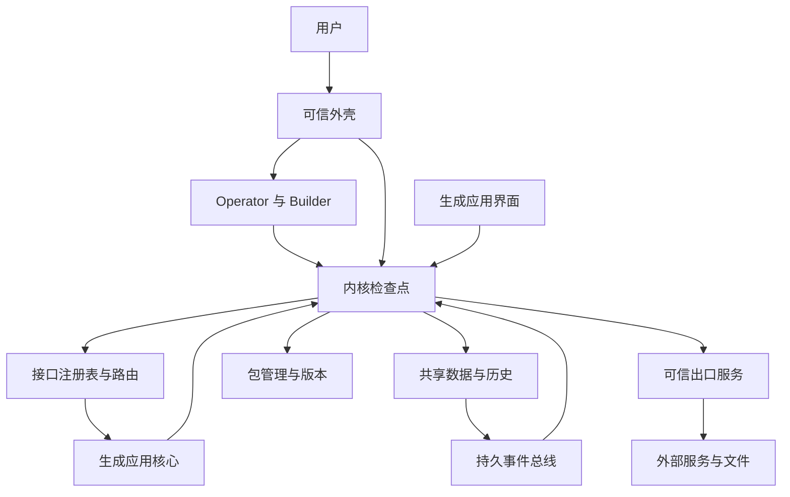
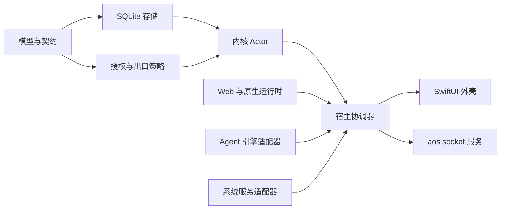
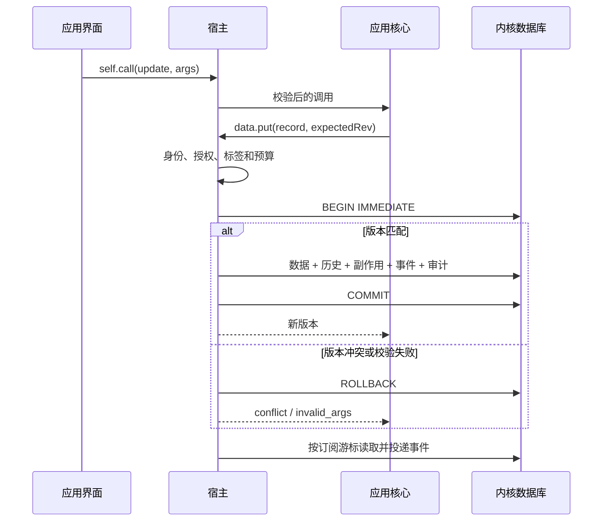
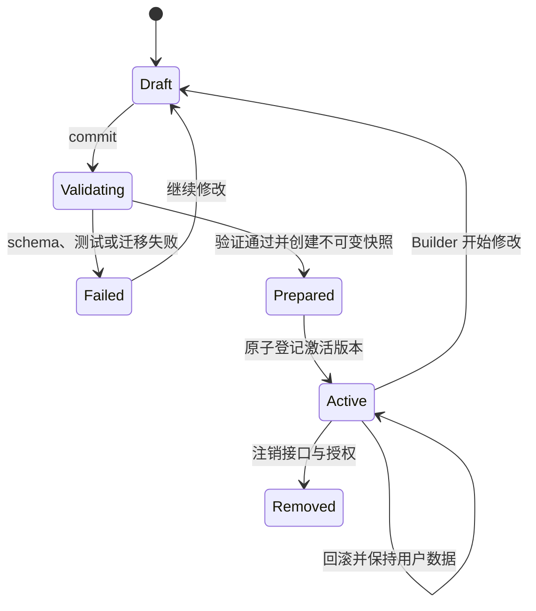
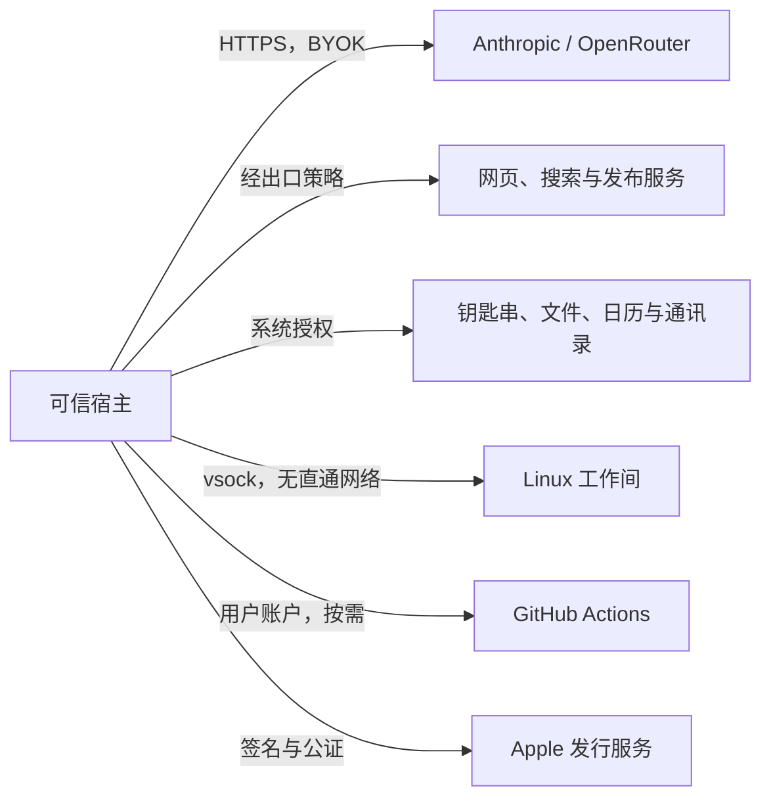
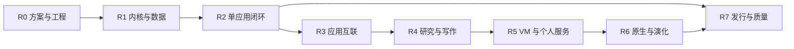

# AgentOS 从零重建方案

> 基线：正式技术方案第二版（00–11）、交互设计稿 v0.2。状态：主体开发完成；本地确定性验收通过，外部与体验验收待完成。
> 本方案描述重建的完整范围；阶段通过必须有测试或实际演示证据，不能用接口占位代替完成。

## 1. 方案结论

重建一个 macOS 26 上的个人工作环境。Swift 宿主提供可信内核、数据、权限、版本、系统服务和恢复。生成应用分成无界面核心与界面，所有写入和外部操作经过宿主。Builder 交付源码、接口、规格和测试；Operator 使用同一套接口办事。

先完成可验证的本地闭环，再接外部服务、VM 和原生应用。四条体验验收线是生成应用、笔记联动待办、外部内容触发自动化、活动撤销与版本回滚。生成质量、真实账户连通性和发行验证分别记录，不以演示数据冒充。

当前 P0 只作为实验和沙箱回归资料。重建不以其对象结构为约束。新运行使用独立数据根目录；不自动修改旧 P0 数据。

### 1.1 范围

包含 00–11 的核心范围：可信外壳、内核、共享数据、应用包、Web 核心与界面、协议投影、事件、自动化、Agent、网络与文件、研究写作、邮件日历与媒体、工作间 VM、原生构建、可生成外壳、恢复、导入导出和发行工程。

正式方案中标为按需或可选的云构建、macOS 来宾 VM、远程 MCP 暴露保留为独立出口；不把未配置的服务展示为可用。多设备同步和重型专业应用继续不在范围内。

### 1.2 决策登记

| 决策 | 状态与选择 | 理由与代价 |
|---|---|---|
| 平台 | 用户已确认：最低 macOS 26 + Apple Silicon | 与新版正式方案一致；旧系统与 Intel 不承诺支持 |
| 产品边界 | 已确认：仅 macOS、站外分发、BYOK | 不引入自营模型账户或跨平台框架 |
| Agent 权限 | 已确认：高权限，三档模式，出口把关 | 应用授权和运行委托链始终有效；完全信任不绕过沙箱 |
| 应用结构 | 已确认：core.js + ui/；IDL 是唯一接口来源 | UI 写共享数据必须经核心；测试不能依赖 UI 打开 |
| 数据迁移 | 用户已确认：从空系统开始，暂不迁移旧 P0 数据，旧目录保留 | 避免将原型状态变成新系统的隐式依赖 |
| 本地持久化 | 实施决定：先用系统 sqlite3，单个宿主数据库、WAL、绑定参数 | 数据、历史、副作用和事件在一个事务提交，消除跨库一致性缺口；代价是自行维护小型数据库封装 |
| 撤销 | 实施决定：按副作用记录做字段级反向写入；冲突返回，不覆盖 | 保留后续独立修改；不承诺不可逆操作能够撤销 |
| 安装 | 实施决定：验证、契约测试、迁移预检全部在激活之前；数据库保存激活版本 | 文件准备失败不改变当前版本；启动时按登记的版本恢复指针 |
| 事件投递 | 实施决定：每订阅有序串行，持久租约、重试与死信 | 首版限制吞吐以获得清晰的确认语义；应用仍须幂等 |
| 外部账户 | 配置决策：用户通过设置连接真实账户；开发用显式测试适配器 | 未配置时返回 unavailable；禁止伪造成功 |
| 发行 | 外部前提：Developer ID、公证身份、干净 Mac | 本地开发可进行；缺少条件不能宣称发行验收通过 |

产品边界、Agent 权限等沿用既有正式文档。2026-10-16 用户另行确认最低系统与空系统启动，并要求暂缓付费模型评测。表内其余实施决定并非新增的人类批准；可在保持接口契约的条件下调整。

| 需要先明确的分歧 | 本次采用的决定 | 剩余确认或条件 |
|---|---|---|
| 旧数据是否迁入 | 独立新数据根，保留原型目录；仅显式导入 | 如需迁入旧应用，另行确定映射，不自动迁移 |
| VM 网络与目录共享 | 无网卡；vsock 显式出口；授权文件复制 | 通用透明联网和 virtiofs 不进入当前实现 |
| 后端隔离 | 每应用独立 VM；Python、Node 或 OCI；契约测试另建临时 VM | 需用户安装镜像；发行镜像来源和公钥待配置 |
| schema 演化 | 声明式字段迁移、完整预检、备份、原子激活 | 跨多个应用的联合迁移不自动执行；接口破坏性变更先解决依赖 |
| 代码构建 | 原生固定 swiftc；WASM core module v1；OCI 标准镜像布局 | SwiftPM 插件、WASI/Component Model、云构建保留按需扩展 |
| 模型质量与费用 | 用户已决定先完成无付费验证，暂缓 S3/S4/S6 真实模型评测 | 默认 Opus 5.5、单次预算 3 美元的产品配置不代表授权本轮付费实跑 |
| 发行验收 | Release hardened runtime、签名脚本、Sparkle 接口 | Developer ID、公证 profile、更新源、条款和干净 Mac |

### 1.3 术语

| 术语 | 含义 |
|---|---|
| 主体 Principal | 宿主认定的用户、运行、应用核心、应用界面或服务身份 |
| 运行 Run | 一轮用户请求或一次自动化，关联预算、标签和副作用 |
| 副作用 Effect | 一次可审计的写入或出口操作，保存撤销所需信息 |
| 标签 Labels | 来源可信度、污点来源和机密性，随会话、实例和记录传播 |
| 接口定义 IDL | interface.json 中的工具 schema、数据、调用和订阅申请 |
| 出口 Sink | 网络、邮件、发布等能产生系统外部影响的可信服务 |

## 2. 总体设计

下图说明执行与信任边界。

- 宿主按连接认定身份，不接受应用自报的 runId、权限或标签。
- 数据、事件和活动流共用持久化事实；界面不维护另一份业务真相。
- 外部内容进入后标签粘性传播。出口决策依据实际能力、参数和标签。

模块边界按可测试能力划分。

- 无 UI 的契约、内核和持久化放进 Swift Package，独立运行测试。
- WebKit、窗口、钥匙串和系统授权属于 macOS 宿主。
- 引擎保持 stdio JSON-RPC 边界；不直接持有数据和出口权限。

### 2.1 模块和交付物

| 模块 | 责任 | 主要接口 | 依赖 |
|---|---|---|---|
| Contracts | JSON 值、IDL 校验、错误与兼容性 | Schema / AppInterface / HostError | 无 |
| Kernel | 身份、委托、运行、授权、标签、预算、审计 | startRun / authorize / record / finishRun | Contracts、Storage |
| Data | schema、乐观并发、查询、历史、撤销 | put / get / query / batch / undo | Kernel |
| Packages | 工作区、快照、验证、激活、回滚、卸载 | create / commit / versions / rollback | Kernel、Contracts |
| Runtime | 核心与界面隔离、SDK、自测、资源回收 | call / load / reload / contractTests | Kernel、Packages |
| Protocol | 搜索、描述、路由、MCP/CLI 投影 | apps.search / describe / call | Runtime、Kernel |
| Events | 持久订阅、投递、确认、重试、死信 | subscribe / next / ack / fail | Data、Kernel |
| Automation | 固定计划、事件和定时触发、配额、恢复 | create / pause / run | Events、Protocol |
| Agent | Operator/Builder、会话、取消、生成修复 | session/prompt / update / cancel | Host 工具 |
| Services | 文件、网络、模型、邮件、日历、媒体等 | 统一出口接口 | Kernel、平台框架 |
| Workbench | VM、vsock、授权共享、资源、快照 | exec / fs / service / snapshot | Kernel、Services |
| Shell | 启动台、多标签、对话、活动、设置、确认 | Host 的可观察状态 | Host |

### 2.2 写入、事件与撤销

下图说明一次数据修改及其失败路径。

- 任一写入失败均不留下半条活动或事件。
- 撤销是新的事务，使用 before/after 和后续字段历史检测冲突。
- 创建记录后若又被修改，撤销创建不能删除新内容；返回冲突。
- 删除需要版本条件；撤销删除不覆盖此后重建或修改的记录。

### 2.3 应用生命周期

- 运行中的稳定应用始终加载已激活快照；开发预览明确标识为未发布。
- 回滚恢复代码工作区和接口版本；共享数据、游戏存档保留。
- 卸载不删除共享集合；删除和导入不能触达宿主私有目录。

### 2.4 外部依赖

- 未配置凭据的能力明确不可用，其余本地功能继续工作。
- 测试账户、真实账户和测试数据根目录分离。
- 开发不执行真实发信、发布、付款或永久删除来证明接口可用。

## 3. 可靠性与体验契约

| 问题 | 处理 |
|---|---|
| 调用超时或取消 | 截止时间与取消令牌由宿主保存；过期后的数据写入拒绝，结果丢弃 |
| 事件重复 | 事件 ID 稳定；订阅确认持久化；示例核心以 source ID 幂等写入 |
| 重启 | 未结束运行标记中断；事件租约过期可重试；安装准备记录可清理 |
| 权限撤销 | 每次调用和投递重新校验；不复用之前的授权结果 |
| 标签清除 | 新会话或真正新实例才可重置；开发热重载保留标签 |
| 模型预算 | 宿主记录用量并取消超限运行；不承诺模型提供商计费绝不超过上限 |
| 外部调用不确定结果 | 记录 unknown，不自动重发不可逆操作；可查询时先核实状态 |
| 私人数据 | 实验性模型默认不得接收；模型接入与工具结果交付都校验 |
| 安装路径 | 拒绝绝对路径、..、符号链接逃逸和包炸弹；限定文件数与大小 |
| 沙箱 | 同应用 origin、主 frame、固定根目录、无直通网络、独立宿主 world |

外壳遵循设计稿：墨色背景、暖白正文、橙色 Agent 动作、薄荷色事件、琥珀色外部来源。首次打开显示空启动台和可执行建议；不预装假的用户应用。提供明确的生成中、测试中、等待确认、取消、失败和可重试状态。工具完成后显示简短结论，活动可展开原因、参数和副作用。

## 4. 开发顺序与阶段验收

以下阶段对应正式路线图，但把发布验证单列，避免将本地运行等同于可分发。

| 阶段 | 交付物 | 前置 | 验收出口 |
|---|---|---|---|
| R0 方案与工程 | 本方案、独立工作区、构建测试入口、隔离数据根 | 无 | 全部决策有状态；构建工具可用；原数据不被修改 |
| R1 可信基础 | 契约、SQLite、内核、授权、运行、标签、历史与撤销、审计 | R0 | 无授权写入失败；UI 写入失败；版本冲突无部分提交；撤销保留独立后续修改；审计篡改可检测；重启后数据保留 |
| R2 单应用完整闭环 | 包管理、核心宿主、JS SDK、路由、Builder、外壳 | R1，S1/S2 | 生成笔记应用；界面和 Agent 操作同一工具；契约测试在临时数据上执行；失败版本不激活；回滚保留数据；沙箱回归全通过 |
| R3 应用互联 | 事件总线、自动化、权限页、多标签、aos | R2 | 关闭界面仍能笔记→待办；事件重复不产生重复任务；重启补发；撤权立即停投；工具升级兼容检查；CLI 与 UI 授权一致 |
| R4 研究与写作 | 文件、搜索、网页、浏览器、AI、发布、完整出口策略 | R3 | 研究→引用→文档草稿可追溯；注入不能未经确认发布；私人数据不能发给受限模型；文件路径和重定向检查通过 |
| R5 工作间与个人服务 | VM、后台进程、邮件、隔离解析、日历通讯录、媒体、MCP 驱动 | R4，S7 | 无网卡 VM 执行命令；未授权共享不可读；外部邮件触发固定计划；日历可补偿；发信不可撤销标记；主窗口关闭后台继续；真实账户连通另验 |
| R6 原生与演化 | 原生构建运行、WASM、包导入导出、可生成外壳、恢复 | R5 | 原生崩溃不影响宿主；应用默认禁网；篡改包拒绝；外壳失败自动恢复；核心可信 UI 不被覆盖；可选能力单列验证 |
| R7 发行与质量 | 签名、公证、升级、性能和生成评测、使用文档 | R2 起贯穿，所有阶段结束 | S1 一小时；S4 四类各十次生成达标；S6 二十任务；S5 签名公证和干净 Mac 实测；所有验收有结果和日志 |

依赖关系如下。

- 每阶段先通过确定性测试，再运行 UI 和真实模型验证。
- S1/S2 是核心运行时的合入门槛；S5 是发行门槛。开发阶段可先使用 ad-hoc 构建，但不标记可发行。
- 共享模型和协议稳定后才扩展出口；不会用后续阶段的安全机制替前面阶段补安全承诺。

## 5. 执行记录与剩余验收

| 阶段 | 实现与确定性验证 | 阶段完整验收状态 |
|---|---|---|
| R0 方案与工程 | 独立工作树与数据根；Swift Package、Host、引擎、UI Kit、CI、使用文档 | 本地通过；代码提交 057fcab 的远端 CI 通过，平台限制见验收记录 |
| R1 可信基础 | 55 项内核/服务测试通过；事务、撤销、撤权、标签、预算、审计、迁移、恢复、包完整性 | 本地通过 |
| R2 单应用闭环 | 真实无窗口核心、JS SDK、UI Kit、契约测试、Builder 适配、版本/回滚、完整沙箱回归；桌面夹具打开、写入、回滚与独立窗口通过 | 真实模型生成质量按用户决定暂缓 |
| R3 应用互联 | 关闭 UI 的笔记→待办；重复投递幂等；撤权；兼容升级暂停自动化并重新批准；CLI；真实前后台交接 | 确定性与桌面笔记→待办路径通过 |
| R4 研究与写作 | 文件和流式读取、搜索/网页/浏览器、模型服务、本地语义查询、引用传播、GitHub 发布及 unknown 状态 | 服务适配和注入边界通过；S6 真实模型与外部账户待验 |
| R5 VM 与个人服务 | 真 VM Python/Node/OCI、持久后端、授权 HTTPS、临时磁盘；邮件解析/去重/自动化；日历补偿、通讯录、媒体、MCP | 无网卡与冷磁盘恢复通过；完整内存恢复失败；真实账户/播放/发行镜像待验 |
| R6 原生与演化 | 固定 swiftc 编译、独立进程沙箱与重启、WASM 核心模块、签名包往返、声明式迁移、集合备份/时间点恢复、自定义桌面回退 | 自动化测试通过；备份恢复确认与恢复模式已实际点击通过，自定义桌面完整生命周期待验 |
| R7 发行与质量 | 一小时核心探针；Debug 运行与 ad-hoc hardened Release 构建/sidecar；Sparkle、发行脚本；S3/S4/S6 入口与免费预检 | 不具备发行通过结论；付费质量、公证、签名更新与干净 Mac 待验 |

### 5.1 已验证的主要结果

- 解锁后的无付费桌面验收通过所列路径：设置与键盘、标签、笔记联动、版本回滚、活动撤销和详情、备份恢复拒绝/批准、独立窗口、恢复模式。发现的问题已修复并复测，详见[桌面记录](../verification/2026-10-16-desktop.md)。手写夹具不代表模型生成质量。

- `make check`：55 项 Swift 测试，WebKit 沙箱与集成，原生编译/沙箱，4 项 OCI 布局解析测试，TypeScript 检查和 Debug 构建。
- S1：无窗口核心连续 3600.105 秒，721 次调用，零失败，p95 13.316 ms；宿主峰值 RSS 69,107,712 字节，单独采样 WebContent 峰值 RSS 30,261,248 字节。两项峰值不代表同一时刻的总内存。见 [机器结果](../verification/2026-10-16-core-host-memory.json)。
- 真 VM：无硬件网卡；直接 socket、未授权域名及伪造令牌被拒绝；经宿主授权访问 HTTPS 成功；Node 与 OCI 契约测试不污染实际后端；核心授权撤销立即阻断后续调用。
- 数据演化：迁移预览绑定当前 schema 和每条记录版本；预览后写入会使提交失效；契约失败不迁移；备份和恢复保留来源/私人标签；历史 schema 可解析。
- 原生进程崩溃后宿主与共享数据仍可用，下一次工具调用重建核心进程。

完整命令、证据范围和失败记录见 [验收记录](../verification/2026-10-16-rebuild.md)。

### 5.2 尚未通过的验收

| 条件或问题 | 下一步 | 通过标准 |
|---|---|---|
| 桌面交互 | 用户已解锁，继续按设计场景检查键盘、窗口、确认和恢复；无付费部分使用显式临时夹具 | 确定性桌面操作有实测证据；模型生成另验 |
| 真实模型与预算 | 用户要求暂缓；本轮仅运行无付费验证，不调用模型 | 后续重新授权后：S3 有可比较结论；S4 40 次且一次通过率≥80%、接口覆盖≥90%；S6 20 次平均确认<1且任务完成 |
| 真实账户 | 连接专用邮件、日历、MCP 与发布测试账户 | 读取、授权撤销、失败恢复；真实发送/发布只在用户明确发起时验证 |
| VM 内存恢复失败 | 独立最小复现 `VZErrorDomain Code 12`，定位平台/签名条件 | 完整状态恢复通过；当前仅可使用显式冷磁盘恢复 |
| 发行镜像 | 选择可分发 kernel/rootfs，托管签名清单与文件，提供独立可信公钥 | 下载、签名/哈希拒绝、更新、许可证与供应链信息核实 |
| App 正式发行 | Developer ID（Release 宿主加载 Sparkle 需要 Team ID）、公证 profile、Ed25519 更新源、SDK 再分发条款核实、干净 Mac | 公证、Gatekeeper、首次安装、更新、模型调用全部通过 |

### 5.3 当前实现的明确边界

- 数据迁移支持用户集合的顶层字段 rename/default/remove；集合恢复有 10000 条/50 MB 预检上限。跨应用联合 schema 迁移、按应用/运行筛选的整组时间点恢复尚未实现。单个副作用仍可逐项撤销。
- 原生构建固定为 swiftc，无包自带脚本；WASM 是 WebAssembly core module，不是 Component Model/WASI。
- OCI 后端接受 linux/arm64、`app` 标签的 image-layout tar，在来宾用 umoci/runc 解包与运行。它不直接拉取任意容器仓库，也不接受 Docker save 旧格式。网络仍走内核出口。
- 镜像更新更新基础镜像；已有持久磁盘保持原环境，新建临时实例/新后端使用新版本。磁盘内工具链不自动原地升级。
- 自动化首版是固定工具序列与事件/定时触发；后台遇到需要确认的出口暂停并通知。没有无人看管的自由规划循环。
- 数据导出为带 schema/标签的 JSON，不包含授权文件夹的媒体原文件和附件。历史和应用版本尚不自动压缩删除，避免不可逆丢失。

这些边界已同步至正式分册。**主体开发完成不等于整个方案验收通过**；上述未通过项继续作为后续工作的具体入口。
